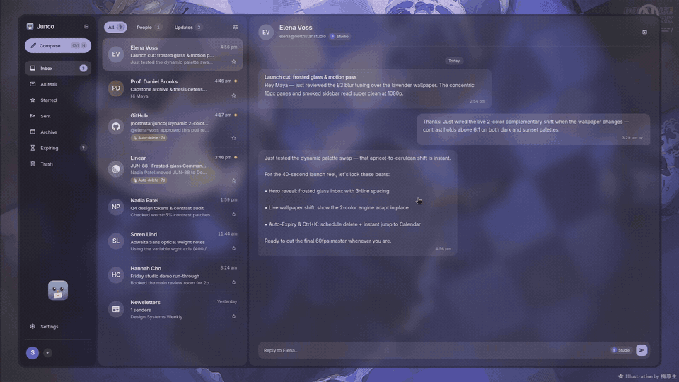
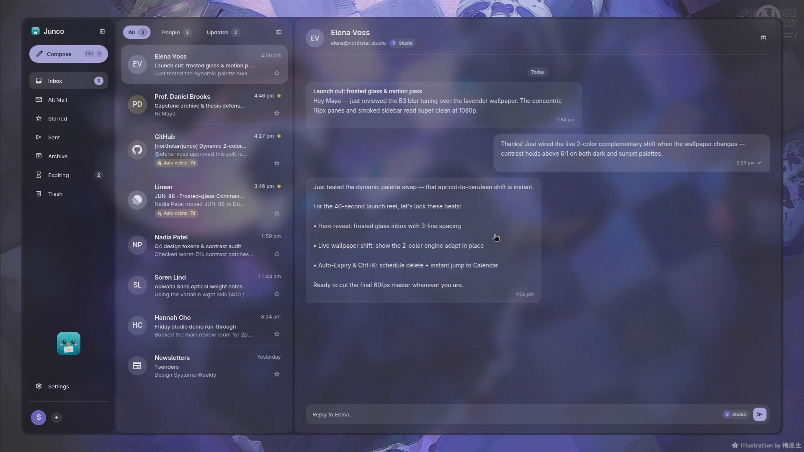
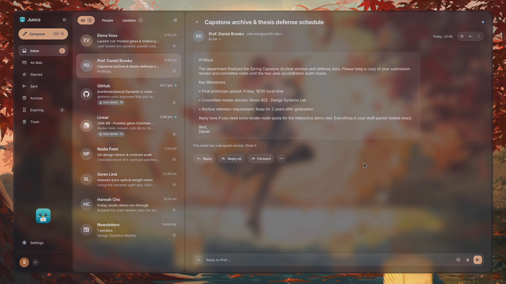
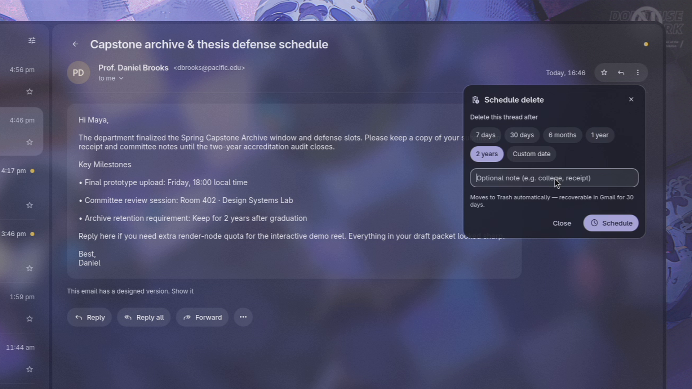
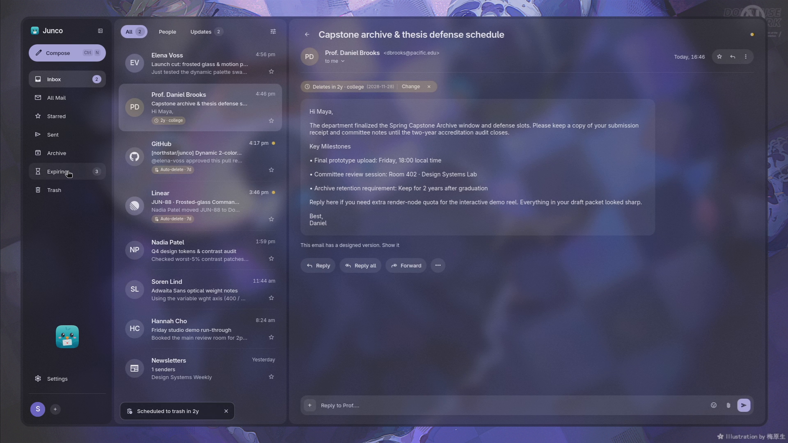
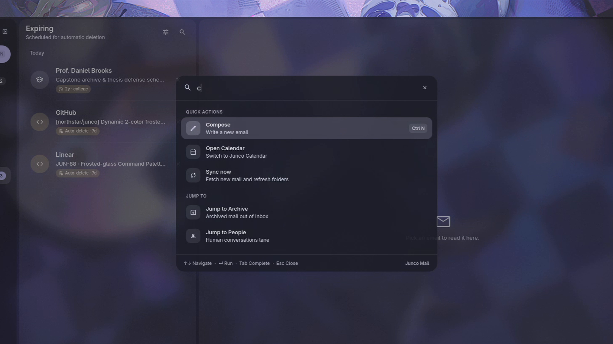
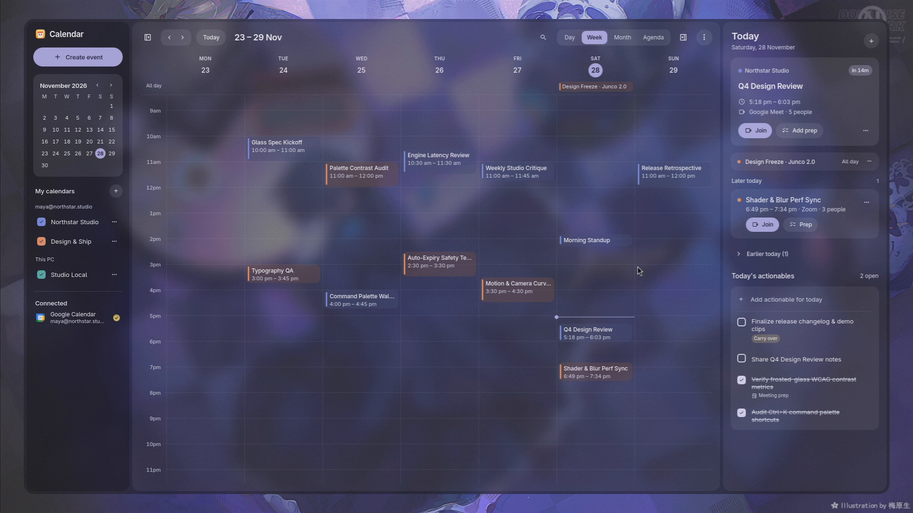

# Junco

**A mail client for Linux that feels like part of your desktop.**



Junco is a Gmail client and a calendar for Hyprland, drawn with frosted glass,
system typography, and live wallpaper colours from the shell around it. It runs
natively: no Electron and no embedded browser.

Its commands, files and services still use the code name `courier`
(`courier-auth`, `~/.config/courier`, `courier-sync.timer`).

## Features

- **Dynamic 2-color frosted glass.** Neutral translucent surfaces sit over
  Hyprland compositor blur, with primary and complementary accents driven live
  by Caelestia's `scheme.json` whenever your wallpaper changes, in both Light
  and Dark modes.
- **Chat-like inbox and clean reader.** Calm 3-line conversation rows, resizable
  panels, and `All / People / Updates` lanes keep people first and group
  machine senders and newsletters out of the way. Simple emails follow your
  theme's colours, designed newsletters stay on paper, and notification mail
  renders cleanly with native Qt rich text — zero Electron or WebView.
- **Mail Auto-Expiry and Scheduled Delete.** Per-provider auto-cleanup rules
  (such as GitHub and Linear after 7 days) move old updates to Trash by default
  while skipping starred threads. You can also set a per-thread timer via
  **Schedule delete…** (for example `2y · college`) and review everything in
  the **Expiring** folder.
- **Calendar built around Today.** A separate app with Google Calendar sync,
  local events, and desktop reminders, centred on a **Next-Up Meeting
  Spotlight** with a live countdown and Join button, collapsible **Earlier
  today**, SQLite-backed **Today's Actionables** with `Carry over` tags, and a
  top-bar upcoming meeting feed.
- **Frosted-glass Command Palette (`Ctrl+K`).** Instant keyboard navigation and
  actions across Mail and Calendar without leaving the keyboard.
- **Multiple Gmail accounts**, together or one at a time, each with a small
  account badge and Google or custom-framed profile picture.
- **Selection bar and empty-send guard.** Archive, delete, mark read or star
  many emails at once, and get a prompt before sending an email with nothing of
  yours in it.
- **Structured notifications.** A GitHub email becomes "CI failed · app ·
  main" or "Review requested · PR #274" with buttons, not "New mail from
  GitHub". Security alerts, expiring domains and failed payments pop up while
  digests stay silent — quiet by default.

## How it works

The interface is QML on [Quickshell](https://quickshell.org). A small Python
engine syncs and indexes mail with `mbsync` and `notmuch`, sends with `msmtp`,
and keeps your Google sign-in in the system keyring. More in
[HOW-IT-WORKS.md](HOW-IT-WORKS.md) and [docs/GUIDE.md](docs/GUIDE.md).

### Tech Stack

| Layer | Technology |
| --- | --- |
| UI & Windowing | **Qt 6 / QML** on [Quickshell](https://quickshell.org) — zero Electron, zero embedded browser |
| Compositor & Glass | **Hyprland (Wayland)** compositor blur + live Caelestia `scheme.json` theming |
| Mail Tools (C) | [`mbsync`](https://isync.sourceforge.io) (`isync`), [`notmuch`](https://notmuchmail.org), [`msmtp`](https://marlam.de/msmtp/) |
| Local State | **SQLite** (auto-expiry rules & schedules, Today's Actionables, calendar cache) |
| Background Engine | Lightweight **Python** (OAuth PKCE, IMAP IDLE push, auto-expiry sweeper, calendar sync, structured notifications) |

## Install (Arch, CachyOS)

You need Python 3.14 or newer, a Google account, and an AUR helper
(`paru` or `yay`).

```sh
sudo pacman -S --needed quickshell isync notmuch msmtp libsecret librsvg kdialog libnotify \
    python-pillow python-markdown-it-py ttf-material-symbols-variable
paru -S cyrus-sasl-xoauth2-git ttf-rubik-vf

git clone https://github.com/JagritGumber/junco ~/Projects/junco
cd ~/Projects/junco
mkdir -p ~/.local/bin
ln -sf "$PWD/bin/courier" "$PWD/bin/calendar" ~/.local/bin/
for tool in auth sync push mail calendar avatars notify; do
    ln -sf "$PWD/engine/courier_$tool.py" ~/.local/bin/courier-$tool
done
```

`~/.local/bin` must be on your `PATH`.

### Your own Google sign-in

Junco ships no Google credentials. Each user creates a sign-in client of
their own, once:

1. In the [Google Cloud console](https://console.cloud.google.com), create a
   project and enable the **Gmail API** and the **Google Calendar API**.
2. Under **Google Auth Platform**, fill in Branding (app name Junco), set Audience to
   External, then **Publish app** so it is *In production*. In Testing, the
   sign-in expires every 7 days.
3. **Clients → Create client → Desktop app**, and download the JSON file.

Then store the client in your keyring, sign in, and run the first sync:

```sh
courier-auth setup ~/Downloads/client_secret_*.json   # then delete that file
courier-auth add personal                             # opens your browser
courier-sync                                          # the first sync takes a few minutes
```

Google warns that the app is unverified, because it is your own client:
choose Advanced → Go to Junco. Add more accounts with
`courier-auth add work`, and so on.

### Background sync and launch

```sh
mkdir -p ~/.config/systemd/user
ln -sf "$PWD"/engine/systemd/* ~/.config/systemd/user/
systemctl --user daemon-reload
systemctl --user enable --now courier-push.service courier-sync.timer courier-notify.service \
    courier-tick.timer courier-calendar.timer courier-remind.timer

courier     # the mail window
calendar    # the calendar
```

Junco takes its colours from the [Caelestia](https://github.com/caelestia-dots/shell)
shell's wallpaper scheme when it is installed, and uses its own dark palette
when it is not. Launcher entries and the rest of the setup are in
[HOW-IT-WORKS.md](HOW-IT-WORKS.md). Run the tests with
`cd engine && python3 -m unittest discover tests`.

## Screenshots

These show the demo profile, with fictional people and mail.

| | |
| --- | --- |
|  |  |
| Frosted-glass inbox with `All / People / Updates` lanes | Live dynamic 2-color shift on wallpaper change |
|  |  |
| Per-thread **Schedule delete…** (`2 years · college`) | **Expiring** folder with `2y · college` and `Auto-delete · 7d` badges |
|  |  |
| Frosted-glass `Ctrl+K` Command Palette | Calendar week view with Next-Up Spotlight & Today's Actionables |

## Part of Kibby

Junco is part of [Kibby](https://github.com/JagritGumber/kibby), a
Hyprland and Quickshell desktop.

## Credits

- [Caelestia](https://github.com/caelestia-dots/shell) (GPL-3.0): Junco
  follows its Material 3 colour roles and look, its transparent layers use
  Caelestia's `alterColour` formula, and the picture framing works like its
  profile picture cropper.
- [Quickshell](https://quickshell.org) (LGPL-3.0), the toolkit the apps are
  built on.
- [Simple Icons](https://simpleicons.org) 16.38.0 (CC0 1.0): the GitHub and
  Linear marks in `shell/services/Brands.qml`. The marks are trademarks of
  their owners.
- The Google Calendar logo (`calendar/assets/google-calendar.png`) is a
  trademark of Google LLC. It is used only to label Google Calendar events and
  is not covered by this project's licence.
- Fonts, installed from packages and not bundled: Rubik (SIL OFL 1.1) and
  Material Symbols (Apache-2.0).
- The mail tools underneath: [isync](https://isync.sourceforge.io) (`mbsync`),
  [notmuch](https://notmuchmail.org) and [msmtp](https://marlam.de/msmtp/).

## Licence

GPL-3.0. See [LICENSE](LICENSE).
