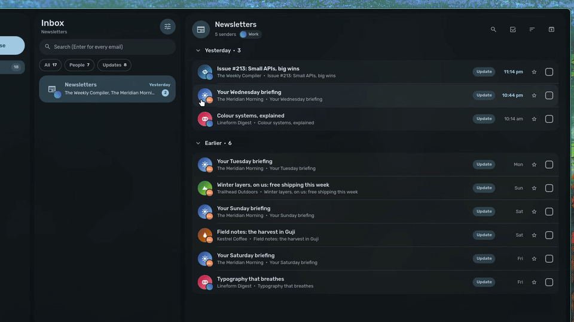
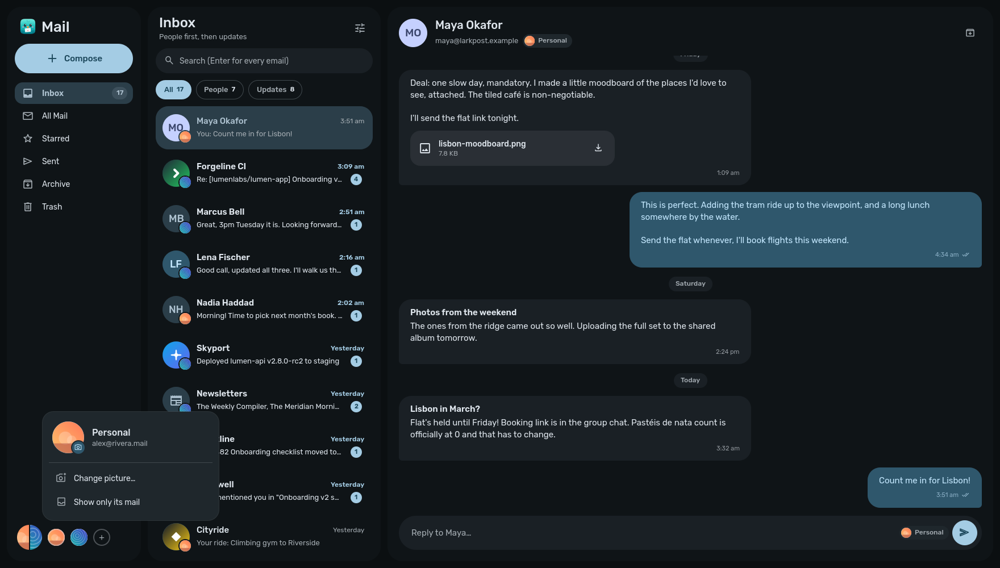
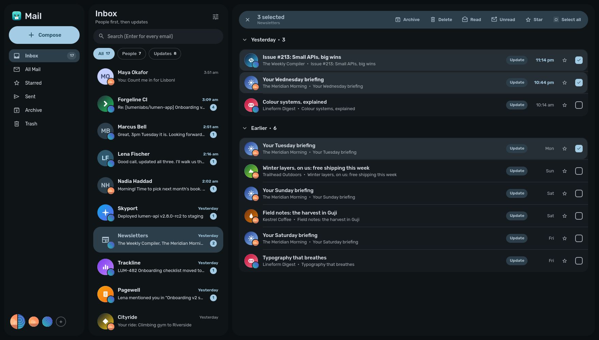
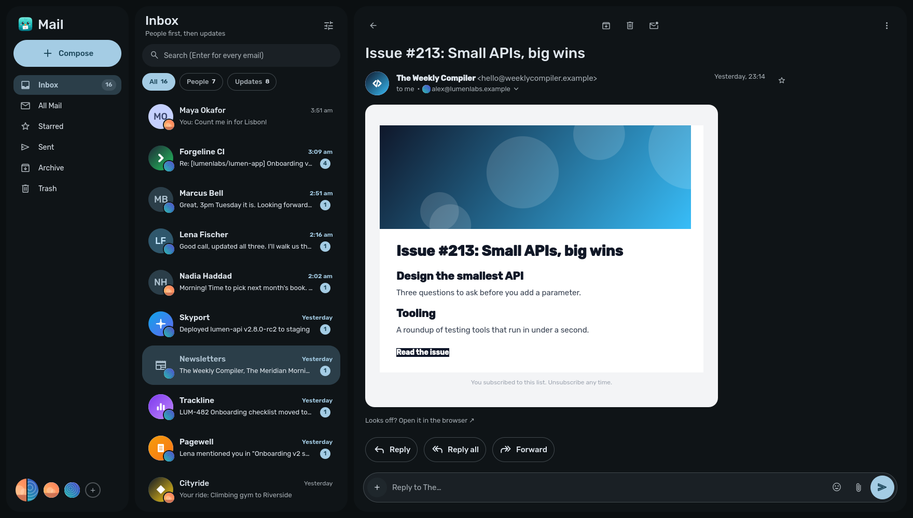
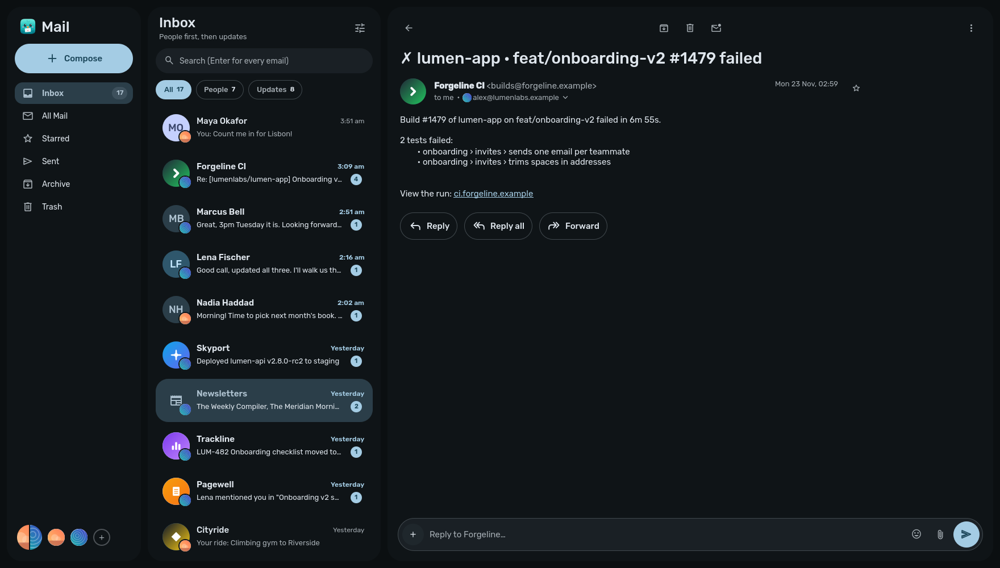

# Courier

**A mail client for Linux that feels like part of your desktop.**



Courier is a Gmail client and a calendar for Hyprland, drawn with the same
fonts, shapes and wallpaper colours as the shell around it. It runs natively:
no Electron and no embedded browser.

## Features

- **People-first inbox.** Each person is a chat with a reply box, and a
  People filter shows only them.
- **Updates and newsletters grouped.** Each machine sender (GitHub, your
  bank, a shop) is one list of its emails, and all newsletters are one list,
  so they never bury a conversation.
- **Multiple Gmail accounts**, together or one at a time. Each email wears a
  small badge for the account it came to.
- **Smart dark mode and native plain text.** Simple emails take your theme's
  colours with their contrast kept, designed newsletters stay on paper, and
  notification mail (GitHub, CI) opens as clean native text.
- **Account pictures.** Your Google profile picture, or any picture you
  frame yourself.
- **Selection bar.** Archive, delete, mark read or star many emails at once.
- **Structured notifications.** A GitHub email becomes "CI failed · app ·
  main" or "Review requested · PR #274" with buttons, not "New mail from
  GitHub". Other services work the same way: security and login alerts,
  expiring domains and failed payments pop up, while digests stay silent.
  Quiet by default: only what needs you pops up.
- **Calendar.** A separate app with your Google Calendar, local events,
  to-dos and desktop reminders.
- **Empty-send guard.** An email with nothing of yours in it asks before it
  goes.

## How it works

The interface is QML on [Quickshell](https://quickshell.org). A small Python
engine syncs and indexes mail with `mbsync` and `notmuch`, sends with `msmtp`,
and keeps your Google sign-in in the system keyring. More in
[HOW-IT-WORKS.md](HOW-IT-WORKS.md) and [docs/GUIDE.md](docs/GUIDE.md).

## Install (Arch, CachyOS)

You need Python 3.14 or newer, a Google account, and an AUR helper
(`paru` or `yay`).

```sh
sudo pacman -S --needed quickshell isync notmuch msmtp libsecret librsvg kdialog libnotify \
    python-pillow python-markdown-it-py ttf-material-symbols-variable
paru -S cyrus-sasl-xoauth2-git ttf-rubik-vf

git clone https://github.com/JagritGumber/courier ~/Projects/courier
cd ~/Projects/courier
mkdir -p ~/.local/bin
ln -sf "$PWD/bin/courier" "$PWD/bin/calendar" ~/.local/bin/
for tool in auth sync push mail calendar avatars notify; do
    ln -sf "$PWD/engine/courier_$tool.py" ~/.local/bin/courier-$tool
done
```

`~/.local/bin` must be on your `PATH`.

### Your own Google sign-in

Courier ships no Google credentials. Each user creates a sign-in client of
their own, once:

1. In the [Google Cloud console](https://console.cloud.google.com), create a
   project and enable the **Gmail API** and the **Google Calendar API**.
2. Under **Google Auth Platform**, fill in Branding, set Audience to
   External, then **Publish app** so it is *In production*. In Testing, the
   sign-in expires every 7 days.
3. **Clients → Create client → Desktop app**, and download the JSON file.

Then store the client in your keyring, sign in, and run the first sync:

```sh
courier-auth setup ~/Downloads/client_secret_*.json   # then delete that file
courier-auth add personal                             # opens your browser
courier-sync                                          # the first sync takes a few minutes
```

Google warns that the app is unverified, because it is your own client:
choose Advanced → Go to Courier. Add more accounts with
`courier-auth add work`, and so on.

### Background sync and launch

```sh
mkdir -p ~/.config/systemd/user
ln -sf "$PWD"/engine/systemd/* ~/.config/systemd/user/
systemctl --user daemon-reload
systemctl --user enable --now courier-push.service courier-sync.timer courier-notify.service \
    courier-tick.timer courier-calendar.timer courier-remind.timer

courier     # the mail window
calendar    # the calendar
```

Courier takes its colours from the [Caelestia](https://github.com/caelestia-dots/shell)
shell's wallpaper scheme when it is installed, and uses its own dark palette
when it is not. Launcher entries and the rest of the setup are in
[HOW-IT-WORKS.md](HOW-IT-WORKS.md). Run the tests with
`cd engine && python3 -m unittest discover tests`.

## Screenshots

These show the demo profile, with fictional people and mail.

| | |
| --- | --- |
|  |  |
| People first, with lanes for the rest | Account card and storage |
|  |  |
| The selection bar | A designed newsletter, on paper |
|  |  |
| A CI notification as native text | The calendar |

## Part of Kibby

Courier is part of [Kibby](https://github.com/JagritGumber/kibby), a
Hyprland and Quickshell desktop.

## Credits

- [Caelestia](https://github.com/caelestia-dots/shell) (GPL-3.0): Courier
  follows its Material 3 colour roles and look, its transparent layers use
  Caelestia's `alterColour` formula, and the picture framing works like its
  profile picture cropper.
- [Quickshell](https://quickshell.org) (LGPL-3.0), the toolkit the apps are
  built on.
- [Simple Icons](https://simpleicons.org) 16.38.0 (CC0 1.0): the GitHub and
  Linear marks in `shell/services/Brands.qml`. The marks are trademarks of
  their owners.
- The Google Calendar logo (`calendar/assets/google-calendar.png`) is a
  trademark of Google LLC. It is used only to label Google Calendar events and
  is not covered by this project's licence.
- Fonts, installed from packages and not bundled: Rubik (SIL OFL 1.1) and
  Material Symbols (Apache-2.0).
- The mail tools underneath: [isync](https://isync.sourceforge.io) (`mbsync`),
  [notmuch](https://notmuchmail.org) and [msmtp](https://marlam.de/msmtp/).

## Licence

GPL-3.0. See [LICENSE](LICENSE).
